<div align="center">
  
</div>

## 👨‍💻 About Me

```javascript
const hwinkdev = {
  pronouns: 'He/Him',
  code: ['TypeScript', 'JavaScript', 'HTML', 'CSS'],
  askMeAbout: ['Web Development', 'Frontend', 'Backend', 'UI/UX'],
  technologies: {
    frontEnd: {
      frameworks: ['Next.js', 'React'],
      state: ['Zustand', 'TanStack Query', 'Redux'],
      styling: ['Tailwind CSS', 'shadcn/ui', 'Sass']
    },
    backEnd: ['NestJS', 'Node.js', 'Express.js'],
    databases: ['PostgreSQL', 'Redis', 'MongoDB', 'Firebase'],
    devOpsAndTools: ['Docker', 'Git', 'VS Code', 'Postman', 'ESLint', 'Prettier']
  },
  currentFocus: 'Building scalable full-stack applications and improving every day.',
  funFact: 'Turning coffee ☕ into scalable web apps and debugging at 2AM 🐛'
}
```

---

## 🛠 Technologies & Tools

<p align="center">
  
</p>

---

## 🔥 GitHub Stats

<p align="center">
  
  
</p>

---

## 💭 Quote of the Day

<p align="center">
  
</p>

---

## 🤝 Connect With Me

<p align="center">
  <a href="https://facebook.com/" target="_blank">
    
  </a>
  <a href="https://www.linkedin.com/in/" target="_blank">
    
  </a>
  <a href="https://instagram.com/" target="_blank">
    
  </a>
  <a href="mailto:hwink.dev@gmail.com">
    
  </a>
</p>

---

<div align="center">
  <h3>⭐️ From <a href="https://github.com/hwink09">hwink09</a> with ❤️</h3>
  <p><b>Thanks for visiting! Let's build something amazing together 🚀</b></p>
  
</div>
